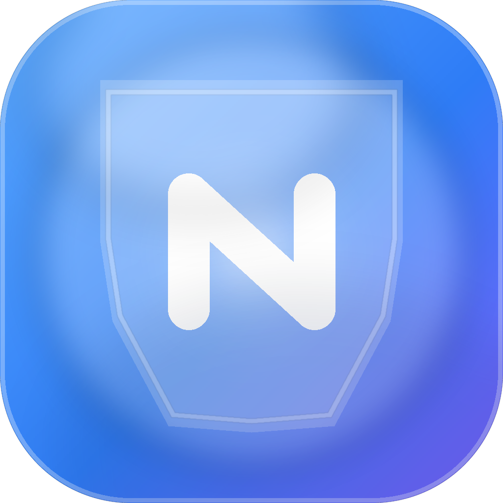

<div align="center">



# NovaProtect

**Windows PE Code Protection Workbench**

A comprehensive code protection and obfuscation platform for Windows PE executables, featuring intelligent mutation strategies, custom protection profiles, and real-time monitoring.

[](LICENSE)
[](https://github.com/sudfiona/NovaProtect/releases)
[](https://github.com/sudfiona/NovaProtect/releases/download/3.2.7/NovaProtect-Setup-3.2.7.exe)
[](https://nova.fbi.plus)

[English](#english) | [中文](#中文)

---

## 中文

### 🚀 功能特性

NovaProtect 是一款专为 Windows PE 可执行文件设计的代码保护工作台，提供以下核心功能：

#### **1. 智能保护引擎**
- 🔐 **多层加密**：Stub、运行时核心、变异内核三层独立加密
- 🎲 **基因算法变异**：每次编译生成不同的壳体结构，规避特征识别
- 🛡️ **完整性校验**：PE 文件、导入表、节表多维度完整性验证
- 🔄 **实时反演**：防护代码与目标代码动态混淆，难以静态分析

#### **2. 灵活的项目管理**
- 📂 创建和管理多个保护项目
- 🎯 按函数或模块级别选择保护对象
- 📊 实时预览保护前后的文件大小、执行性能
- 💾 保存和复用保护配置模板

#### **3. 可视化工作流**
- 🖥️ 直观的 WinUI 3 现代界面
- 🎨 玻璃、波普、实验室三套设计主题
- 🌍 完整的中英文双语支持
- ⚡ 实时构建日志与进度追踪

#### **4. 版本管理与自动更新**
- 🔗 与 GitHub Releases 自动同步版本信息
- 📈 完整的版本历史与变更追踪
- 🔄 客户端自动检测和下载最新版本
- 🌐 官网与客户端独立版本号管理

---

### 📥 下载安装

#### 最新版本：**3.2.7** (2026-11-25)

从 [GitHub Releases](https://github.com/sudfiona/NovaProtect/releases) 下载最新的安装包：

```
NovaProtect-Setup-3.2.7.exe  (61.6 MB)
```

**系统要求：**
- 操作系统：Windows 10 / 11 (x64)
- 运行时：.NET 10.0+
- 内存：2 GB 最低，4 GB 推荐
- 磁盘空间：500 MB

**安装步骤：**
1. 下载安装包
2. 双击运行 `NovaProtect-Setup-3.2.7.exe`
3. 按照安装向导完成安装
4. 首次启动时会自动检查更新

---

### 🎯 快速开始

#### 创建第一个保护项目

```
1. 启动 NovaProtect 客户端
2. 点击左侧导航栏 "新建项目"
3. 输入项目名称和选择目标 PE 文件
4. 在 "保护选项" 标签页配置保护策略：
   - 加密级别：标准 / 增强 / 最大
   - 变异模式：基础 / 进阶 / 自定义
   - 完整性检查：启用 / 禁用
5. 点击 "开始保护" 执行编译
6. 保护完成后，受保护的文件将保存到输出目录
```

#### 命令行构建（高级用户）

```bash
# 完整构建（包含所有组件）
./build.ps1 -WinUi

# 仅重新打包客户端（使用已有的构建产物）
./tools/package-client-release.ps1 -SkipBuild

# 运行回归测试
./tests/regress.ps1
```

---

### 📊 v3.2.7 新增功能

**发布日期：** 2026-11-25

#### 主要更新

- ✨ **主题系统优化**  
  三套主题（玻璃、波普、实验室）的视觉体系经过仔细调整，确保在任何页面都能保持一致的设计语言。圆角、色温、材质等细节按主题正确应用。

- 🌍 **完整国际化**  
  侧栏导航、页头标题、能力状态、动态文本等全部支持中英双语切换。查表回落机制确保即使翻译缺项也不会出现白屏。

- 🎨 **交互优化**  
  修复主题切换时的界面还原、设置页初始化、导航状态一致等问题，整体流畅度显著提升。

#### 验证信息

- 回归测试：✅ **ALL PASS（67 项 OK，零 FAIL、零 SKIP）**
- 更新契约测试：✅ **84 项全过**
- 代码签名：✅ **525 文件 RSA-3072/SHA-256 完整性验证**
- 安装包大小：**61,625,016 字节（58.8 MB）**

**[查看完整变更记录](CHANGELOG.md)**

---

### 🏗️ 架构与组件

NovaProtect 由以下核心组件组成：

```
NovaProtect/
├── src/                      # C++ 保护核心代码
│   ├── stub/                # PE Stub（壳体）
│   ├── runtime/             # 运行时保护库
│   ├── mutation/            # 基因算法变异引擎
│   └── host/                # 保护宿主程序
├── ui/                       # WinUI 3 客户端
│   ├── Pages/               # 界面页面
│   ├── Services/            # 业务逻辑服务
│   ├── Controls/            # 自定义控件
│   └── Assets/              # 资源文件（图标、主题）
├── website/                  # PHP 官网
│   ├── lib/                 # 后端逻辑
│   ├── public/              # 前端静态资源
│   └── data/                # 配置数据
├── tests/                    # 测试套件
│   ├── regress.ps1          # 完整回归测试
│   ├── update-client-smoke/ # 客户端更新测试
│   └── releases_parse_test.php  # 版本解析测试
├── tools/                    # 构建和部署工具
│   ├── build.ps1            # 主构建脚本
│   ├── package-client-release.ps1  # 打包脚本
│   └── verify-installed.ps1 # 安装验证
└── docs/                     # 文档
    ├── DESIGN.md            # 设计文档
    ├── API.md               # API 参考
    └── FAQ.md               # 常见问题
```

---

### 🔧 开发与构建

#### 前置要求

- **Windows 10 / 11** (x64)
- **Visual Studio 2022** (带 C++ 和 UWP 工作负载)
- **.NET 10 SDK**
- **PHP 8.1+** CLI (仅用于官网测试)

#### 克隆仓库

```bash
git clone https://github.com/sudfiona/NovaProtect.git
cd NovaProtect
```

#### 完整构建

```powershell
# 设置执行策略
Set-ExecutionPolicy -ExecutionPolicy RemoteSigned -Scope CurrentUser

# 执行构建脚本
.\build.ps1 -WinUi
```

构建完成后，生成的文件位置：
- 客户端：`artifacts/client-installer/3.2.7/NovaProtect-Setup-3.2.7.exe`
- 官网：`artifacts/website-build/`

#### 运行测试

```powershell
# 完整回归测试
.\tests\regress.ps1

# 仅运行客户端更新测试
dotnet run --project tests/update-client-smoke/NovaProtect.UpdateSmoke.csproj

# 仅运行官网版本解析测试
php tests/releases_parse_test.php
```

---

### 📡 版本同步机制

NovaProtect 实现了客户端与官网的自动版本同步，以下文件负责此功能：

| 文件 | 负责 |
|------|------|
| [`ui/Services/UpdateClient.cs`](ui/Services/UpdateClient.cs) | 桌面客户端版本检查、更新日志和安装包下载 |
| [`website/lib/releases.php`](website/lib/releases.php) | 官网 GitHub Releases 解析、缓存同步及离线回退 |
| [`website/public/data/releases.json`](website/public/data/releases.json) | 官网离线版本快照 |

**官网在线同步需求：**
- PHP 启用 `OpenSSL` 扩展
- 启用 `allow_url_fopen` 配置
- 可选：设置 `NP_RELEASES_TTL` 环境变量控制缓存时间（单位：秒，默认 3600）

---

### 🐛 问题报告与反馈

我们欢迎各种形式的反馈和贡献：

#### 功能建议与普通问题
在 [GitHub Issues](https://github.com/sudfiona/NovaProtect/issues) 提交，请附上：
- 版本号（查看"关于"页面）
- 操作系统和 .NET 版本
- 详细的问题描述或复现步骤
- 相关的日志或截图

#### 安全问题
请 **不要** 在公开 Issue 中提交安全相关问题。  
改为通过 [GitHub Security Advisories](https://github.com/sudfiona/NovaProtect/security/advisories) 私下报告。

#### 贡献代码
我们欢迎 Pull Request！请：
1. Fork 本仓库
2. 创建特性分支 (`git checkout -b feature/amazing-feature`)
3. Commit 更改 (`git commit -m 'Add amazing feature'`)
4. Push 到分支 (`git push origin feature/amazing-feature`)
5. 打开 Pull Request

---

### 📜 许可证

本项目源码遵循 [MIT 许可证](LICENSE)。

```
MIT License

Copyright (c) 2026 NovaProtect

Permission is hereby granted, free of charge, to any person obtaining a copy
of this software and associated documentation files (the "Software"), to deal
in the Software without restriction, including without limitation the rights
to use, copy, modify, merge, publish, distribute, sublicense, and/or sell
copies of the Software, and to permit persons to whom the Software is
furnished to do so, subject to the following conditions:

The above copyright notice and this permission notice shall be included in all
copies or substantial portions of the Software.
```

**第三方组件许可证：**
- WinUI 3：MIT License
- .NET Runtime：MIT License
- 其他依赖项：详见各项目的许可证文件

---

### 📚 相关资源

- 🌐 **官网**：[nova.fbi.plus](https://nova.fbi.plus)
- 📦 **Releases**：[GitHub Releases](https://github.com/sudfiona/NovaProtect/releases)
- 🐛 **Issue Tracker**：[GitHub Issues](https://github.com/sudfiona/NovaProtect/issues)
- 💬 **讨论**：[GitHub Discussions](https://github.com/sudfiona/NovaProtect/discussions)
- 📋 **更新日志**：[CHANGELOG.md](CHANGELOG.md)

---

<div align="right">

**Last Updated：** 2026-11-26  
**Maintainer：** [@sudfiona](https://github.com/sudfiona)

</div>

